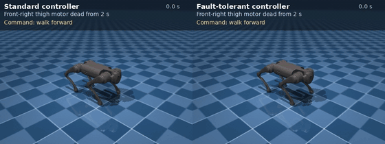
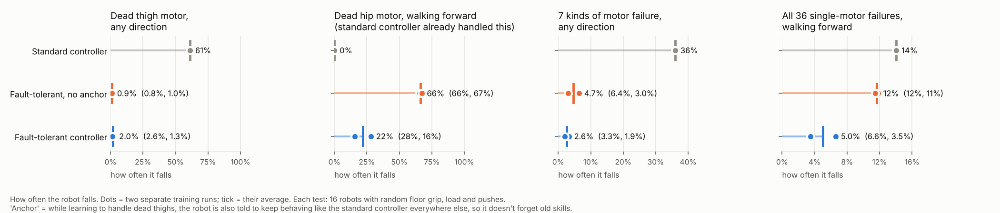
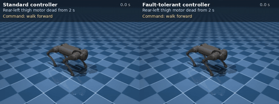

# Fault-tolerant quadruped locomotion (Go1, MuJoCo)

Nowadays, quadruped robot locomotion using RL policies is very popular. I am curious about what would happen if the motors suddenly do not work in the robot (which can happen in real-life). This curioristy has led me to research about fault-tolerant reinforcement learning and innovative strategies. Inspired by **AcL: Action Learner for Fault-Tolerant Quadruped Locomotion Control** (Xu et al., 2025, [arXiv:2503.21401](https://arxiv.org/abs/2503.21401)), specialist teacher policies are trained for hard motor failures, and a single student learns from them. This is just a small experiment but it gives me some ideas about the nature of fault-tolerant policies and how we can further develop it to be more robust. In this project, I used a unitree Go1 and tries to make it keep walking in forward, backward, sideways and turning directions even if one of the motors suddenly dies. 

## What I did

- Trained an all-direction walking controller with random motor failures (dead, stuck, weak).
- Trained two teachers, one for a dead front thigh motor, one for a dead rear thigh motor.
- Distilled them into one student. Fine-tuning made the student *forget* failures it used to
  handle, so I added an **anchor** everywhere the teachers don't apply, the student is also
  pulled toward the original controller's behaviour.

## Results

Simulation, 16 robots per test with random floor grip, payload and pushes.

| how often it falls | standard | fault-tolerant |
|---|---|---|
| dead thigh motor, any direction | 61 % | **2 %** |
| all 36 single-motor failures | 14 % | **5 %** |
| dead hip motor (already handled before) | 0 % | 22 % |

The anchor cut forgetting a lot (dead-hip falls 66 % → 22 %), but didn't remove it.

## Credits

Go1 model: [MuJoCo Menagerie](https://github.com/google-deepmind/mujoco_menagerie) (BSD-3, see
`assets_go1/LICENSE`). Method inspired by AcL (Xu et al., 2025). Reward design follows
legged_gym (Rudin et al., 2022).
